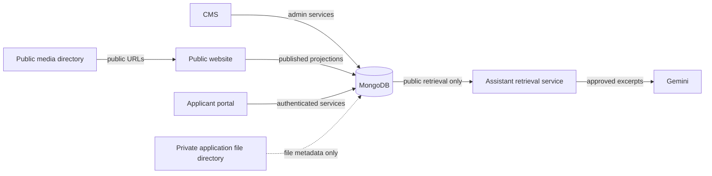

# IRONA MongoDB architecture

## Ownership and flows



The CMS and applicant portal use one MongoDB database, configured by `MONGODB_DB` (default `irona_portal`). Content is stored in `content_items`; vacancies and programs are stored in `opportunities`, alongside portal-created opportunities. CMS vacancy/program IDs remain strings and are preserved. Portal-created records retain their MongoDB `_id` and also receive a stable `id`.

## Collections

| Collection | Responsibility | Important relationships / access |
|---|---|---|
| `users` | Applicant and staff accounts, password hashes, access roles, profile names/photo references and access lifecycle | Unique email index; APIs return `safeUser` fields only. Password hashes never leave the server. Staff use `primaryAdmin`, `accessRoles`, `accessStatus`, `sessionVersion` and `credentialExpiresAt`. |
| `team_profile_photos.files/chunks` | Private staff profile photos in MongoDB GridFS | Referenced by `users.profilePhotoId`; image download requires a signed-in workspace session. |
| `opportunities` | Vacancies, programs, consultancies and portal opportunities | CMS records retain their existing string `id`; applications refer to `_id` for portal records or the stable string `id` at lookup boundaries. Public routes return a field allowlist. |
| `content_items` | News, publications and events | CMS string ID; only published, non-deleted items are public. |
| `applications` | Portal and CMS application submissions | `source` distinguishes legacy workflow metadata; CMS records include preserved legacy IDs; portal records reference applicant and opportunity. Applicant/admin authorization applies. |
| `program_registrations` | Initial program registration and contact details | Linked by canonical program ID; normalized email supports duplicate prevention. Detailed Google Form responses stay in Google Forms. |
| `application_drafts` | Short-lived anonymous application drafts | Raw bearer token is never stored; SHA-256 token hash and MongoDB TTL expiry are used. |
| `notifications` | Applicant-visible status notifications | User-scoped queries and server-side authorization. |
| `audit_events` | Administrative and submission activity without applicant answer contents | Append-only route usage; actor, action, target and time are recorded. |

Collections are validated in MongoDB when created by the application. For collections that already existed before this change, `scripts/apply-validators.js` applies the validator definitions with `collMod`; it requires a temporary database-administrator URI in `MONGODB_MIGRATION_URI`. The normal app account remains `readWrite` and does not attempt administrative schema changes at startup.

Staff role templates are stored as `users.accessRoles` and combined into effective permissions at request time: `administrator` (workspace content and applications), `hr` (vacancies and vacancy applications), `content-publisher` (editorial content), and `program-application-manager` (programs and their applications). Only the environment-configured primary administrator receives `primaryAdmin: true` and can read or change the team directory and security APIs. A staff profile stores `name` and a `profilePhotoId` reference on the same `users` record; photo bytes are held in private GridFS collections rather than the public media folder.

Invitation sign-in passwords are generated as 12-digit numeric codes and bcrypt hashes on the staff user record. The readable value is sent only in the branded invitation email, which links to the normal `/admin.html` sign-in page, and is not returned by an API. `accessStatus: "invited"` plus `credentialExpiresAt` records the 48-hour claim window. First sign-in marks the same retained profile active and clears the claim deadline. The expiry worker marks unused credentials expired while retaining the email, roles and profile. Primary-admin password change/reset revokes invited staff sessions and hashes, marking those records suspended; re-invitation generates a fresh code and deadline for the same user record.

## Indexes

Startup checks for existing key patterns and duplicate keys before creating indexes. Unique indexes are skipped and logged if duplicates are present; startup does not delete or rewrite conflicting records.

- `users.email` unique.
- Staff listing and invitation expiry: `users(accessStatus, credentialExpiresAt, createdAt)`.
- `content_items.id` unique; public listing by type, status, publication time and deletion state.
- `opportunities.id` unique; public listing by type, status and closing date.
- `program_registrations(programId, emailNormalized)` unique.
- `applications(opportunityId, emailNormalized)` unique for `source: "cms"` only.
- CMS drafts: unique `tokenHash` and TTL `expiresAt`.
- Applications: unique opportunity/applicant pair (when duplicate checks pass), CMS opportunity/email pair (when checks pass), applicant/creation time, and status/creation time.
- Notifications: user/creation time.
- Audit events: creation time descending.

Old index definitions with the same key pattern are retained. If an old index is incompatible with a desired unique index, the app logs that it skipped the new constraint; review conflicts and plan an explicit index replacement before changing it.

## API ownership

- `/api/cms/content`, `/api/content`, `/api/public-vacancies`, `/api/public-programs`: canonical MongoDB content and opportunities when connected; local JSON remains only for an explicit disconnected development preview.
- `/api/cms/users`, `/api/cms/invitations`, and staff access-management routes: primary-admin-only team directory, multi-role assignment, suspension and credential re-issue. Invitation passwords are generated, bcrypt-hashed in `users.passwordHash`, emailed once and accepted through the normal `/admin.html` login. An unused invitation credential expires after 48 hours; first sign-in activates the retained account and profile.
- Changing or resetting the primary-admin password suspends invitation-created accounts, removes their password hashes, increments session versions and keeps their email/profile/access history for re-invitation. It does not delete the account records.
- Content, vacancy, program and application APIs check role-derived permissions on each request. `Security & access` is available only to the primary administrator.
- `/api/program-registrations`, `/api/cms/program-registrations`: MongoDB registration records.
- `/api/content-application-drafts`: hashed-token MongoDB drafts and TTL expiry.
- `/api/content-applications`, `/api/vacancy-applications`, `/api/cms/applications`: shared `applications` collection for public CMS submissions.
- `/api/opportunities`, `/api/applications`, `/api/admin/applications`: MongoDB portal workflows. CMS-created opportunities are visible through these public/portal routes.
- `/api/assistant/chat`: uses only dedicated retrieval results built from approved static pages and explicitly projected published records. It does not query accounts, applications, drafts, notifications or private file metadata.

## Migration

Run `npm run db:migrate:dry-run` first. It reports only counts, missing IDs/emails, duplicate source keys and hashed references for ambiguous relationships. It does not connect to MongoDB or print records. Invalid or duplicate source entries block applying. Historical applications whose opportunity was removed are retained with their original reference and `relationshipStatus: "unresolved"`; the importer does not guess a replacement.

`npm run db:migrate:apply` makes a timestamped `.migration-backups/` directory before importing. It copies source JSON files, writes BSON-sequence snapshots of existing MongoDB collections, skips destination IDs already present, blocks on conflicting IDs, imports with preserved logical IDs, and checks destination identity counts. The original JSON and uploaded files are retained. Do not delete them until the application has been verified in a separate release and a backup has been tested.

For recovery, provision an empty recovery database, set the connection string and database name in the environment, and run:

```powershell
node scripts/restore-mongodb-backup.js .migration-backups\<timestamp>
node scripts/restore-mongodb-backup.js .migration-backups\<timestamp> --apply
```

Restore refuses to write into collections that already contain documents. BSON files and copied JSON can contain personal information; keep `.migration-backups/` private, encrypted at rest, and out of version control.

`npm run db:explain` runs read-only `executionStats` explain plans for representative public listings and applicant queries. Run it against a staging database first and review examined documents and winning indexes before production tuning.

## Files and privacy

File bytes are stored in MongoDB GridFS. Published CMS media uses the `cms_public_media` bucket and is served by `/media/:filename`. Applicant documents use the separate `private_application_files` bucket and are streamed only through authenticated, permission-checked endpoints. Team profile photos remain in `team_profile_photos`. File signatures are checked against their declared extension before storage. Vercel function uploads are limited to 3 MB per file, and application documents are limited to 3 MB combined so the multipart request remains below the platform body limit. The `db:migrate:files:dry-run` and `db:migrate:files:apply` commands copy existing local media and application documents into GridFS; they retain the local originals.

The current storage adapter is local filesystem storage under `UPLOAD_DIR`. The repository contains no production host configuration or object-storage credentials, so persistent multi-instance object storage is not implemented here. Production must mount a durable private volume at `UPLOAD_DIR` (and back it up), or provide an approved object-storage service and credentials before deployment. Malware scanning and file-retention automation also remain deployment requirements.

The Security & access page supports database-backed multi-role staff invitations, profile updates, password changes and primary-admin email-code recovery. Invitation-created staff records remain in the team directory after suspension or expiry. The initial 12-digit generated password is bcrypt-hashed in `users.passwordHash`, emailed once, and expires after 48 hours if unused; it is never returned by the API or displayed in the dashboard. Re-inviting rotates the password hash and invalidates old sessions. A successful primary-admin password change or reset suspends all invitation-created accounts, removes their password hashes, expires pending invitations and increments session versions, while retaining their email and profile for re-invitation. The recovery link is on the public sign-in screen, but only the primary administrator account can receive a reset code; teammates use their invitation email or ask the primary administrator to reissue access. Password reset codes are stored as HMAC hashes, expire after 10 minutes, and are attempt-limited. SMTP delivery uses `SMTP_HOST`, `SMTP_PORT`, `SMTP_SECURE`, `SMTP_USER`, `SMTP_PASS`, and `SMTP_FROM`; invitation links use `APP_BASE_URL` in production. Configure Google SMTP with an app password (not the account password), then send a real invitation/reset email to verify delivery. Development defaults `APP_BASE_URL` to the request host. Email delivery depends on the SMTP account being allowed to send as the configured `SMTP_FROM` address.

## Configuration and commands

- `MONGODB_URI`, `MONGODB_DB`, `JWT_SECRET`: app database and session settings.
- `MONGODB_MIGRATION_URI`: temporary elevated connection used only for database-level validators on pre-existing collections.
- `UPLOAD_DIR`: local development and legacy migration source directory. Vercel uploads are stored in MongoDB GridFS, not the function filesystem.
- `MAX_UPLOAD_MB`: upload limit, capped at 3 MB to stay below Vercel's function request size limit.
- `GEMINI_API_KEY`: server-only assistant key.
- `APP_BASE_URL`: public website origin used to build secure invitation links; use HTTPS in production.
- `SMTP_HOST`, `SMTP_PORT`, `SMTP_SECURE`, `SMTP_USER`, `SMTP_PASS`, `SMTP_FROM`: outbound account email settings. Keep `SMTP_PASS` private.

Never print or commit `.env`. Run `npm test` for offline checks. The current tests cover validator definitions and migration dry-run reporting. A separate staging Atlas database is required for end-to-end API, index, migration restore, explain-plan, and chatbot integration tests; the live website database must not be used as a destructive test target. Those integration and Gemini leakage tests have not yet been run.
